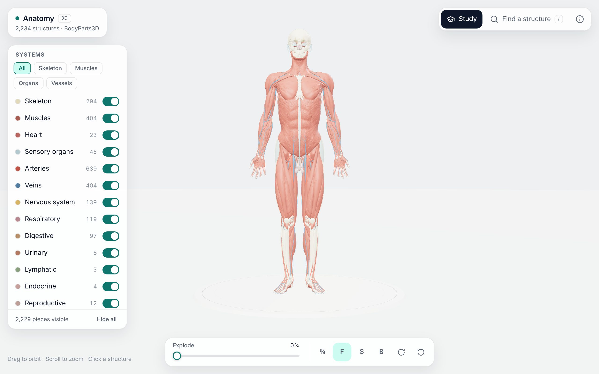
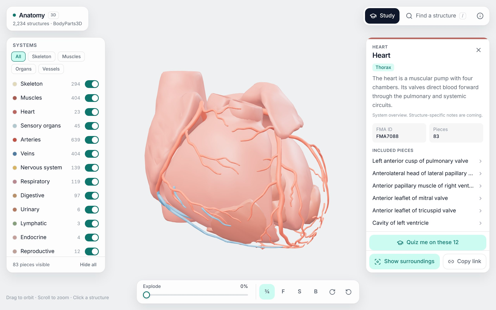
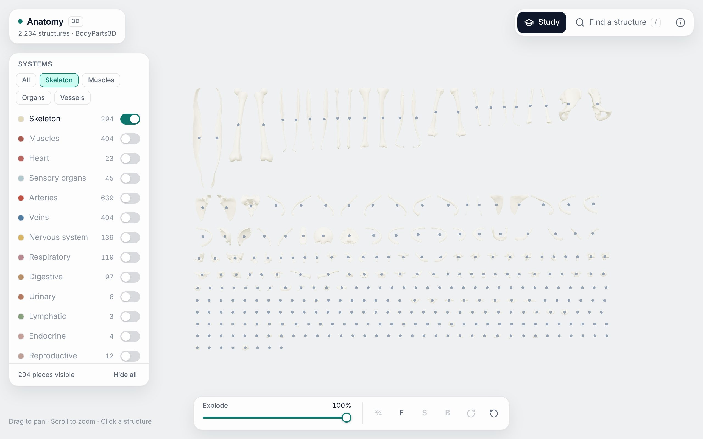
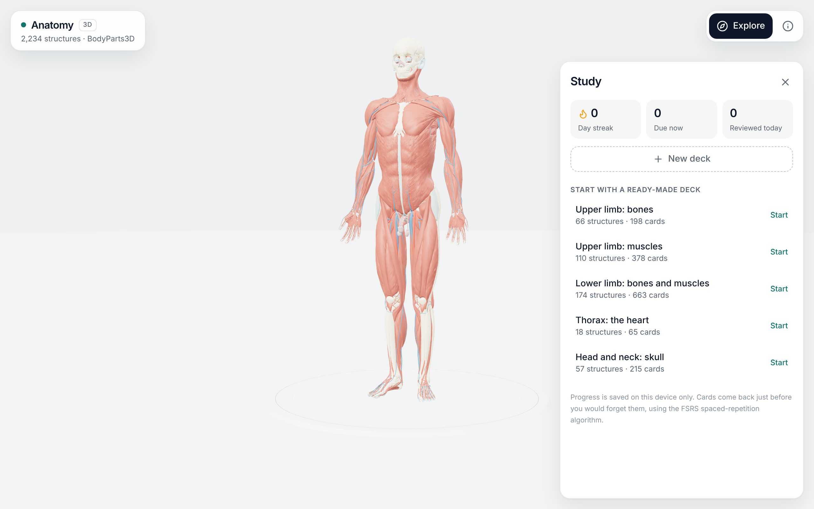

# Anatomy

A free 3D anatomy study app. It's open in the browser with no account: explore 2,234 structures across 15 body systems, isolate any part, and share the exact view by link.

It has two modes. **Explore** is the 3D atlas. **Study** quizzes you on the model and uses spaced repetition, so cards come back just before you would forget them. See [the product plan](docs/PRODUCT_PLAN.md) for the roadmap.

## Screenshots

| Explore                                                                                       | Isolate a structure                                                                                 |
| --------------------------------------------------------------------------------------------- | --------------------------------------------------------------------------------------------------- |
|  |  |
| **Explode into an inventory**                                                                 | **Study**                                                                                           |
|                 |           |

## Features

### Explore

- **Full-body 3D model.** BodyParts3D adult male reference: 2,234 meshes, 3,432 named FMA concepts and 2.3 million triangles, drawn in one call per system.
- **Systems.** Show or hide any of 15 systems, or use the presets (skeleton, muscles, organs, vessels).
- **Explode.** Pull the body apart, then lay every visible piece out flat as an inventory.
- **Search.** Find structures by name (any word order), FMA ID or mesh ID. Press `/` to open it.
- **Inspect and isolate.** Click any structure to see its system, IDs and pieces, then isolate it.
- **Deep links.** The URL always describes the current view (selection, systems, explode, camera), so a copied link reopens it exactly. Example: `/#c=FMA7088&iso=1` opens the heart, isolated.
- **Phones and desktops.** Bottom sheets on phones and side panels on larger screens. Tested at 390×844, 320×568 and 844×390.
- **AI agents.** In browsers with WebMCP, agents can search the atlas and open structures for the user.
- **Info panel.** Region and side, the larger structure a part belongs to, its other parts, and a "Quiz me on this" button.

### Study

- **Six question types.**
  - Find it: we name a structure, you click it on the model.
  - Name it: we highlight it, you choose the name or type it. Small spelling slips are accepted, the wrong side never is.
  - Left or right.
  - Part of: which larger structure a highlighted piece belongs to.
  - Directions: superior/inferior, anterior/posterior and medial/lateral, generated from the model.
  - Which system.
- **Spaced repetition.** The FSRS algorithm schedules each card, with up to 20 new cards a day. Missed cards come back later in the same session.
- **Decks.** Choose body regions, systems and question types, or start from one of five ready-made decks. Share any deck by link.
- **No account.** Progress, streaks and decks are saved in the browser (IndexedDB).

## Run locally

You need Node.js 22.18 or newer.

```sh
npm ci
npm run dev
```

Open http://localhost:3016. The first run downloads and verifies the model data, about 34 MB; later runs use the cache in `.cache/models`.

## Scripts

| Command                  | What it does                                                                       |
| ------------------------ | ---------------------------------------------------------------------------------- |
| `npm run dev`            | Development server                                                                 |
| `npm run build`          | Production build in `dist/` (downloads model data first)                           |
| `npm run preview`        | Serve the production build                                                         |
| `npm run models`         | Download and checksum-verify the model data                                        |
| `npm run validate:atlas` | Check every mesh buffer, index, concept mapping and the triangle count             |
| `npm run report:content` | Write `docs/content/regions-report.md` to spot-check region tags                   |
| `npm run check`          | Typecheck, lint, format check and unit tests                                       |
| `npm test`               | Unit tests (Vitest)                                                                |
| `npm run test:e2e`       | Browser tests (Playwright) against the production build; run `npm run build` first |

## Project layout

```
src/
  atlas/     atlas types, systems, loading, search
  viewer/    AnatomyViewer (three.js renderer), React wrapper, layout and tap helpers
  state/     URL-synced view state for deep links
  ui/        panels, dialogs and controls
  agent/     WebMCP tools
data/        models.lock.json: pinned model source and SHA-256 checksums
scripts/     model download and atlas validation
e2e/         Playwright browser tests
docs/        product plan
```

`AnatomyViewer` is a framework-agnostic class. The UI talks to it only through `setState`, `refit`, `flyTo`, `setHighlights`, `getCamera`/`setCamera` and `setInsets`.

## Deploy to Vercel

1. In Vercel, choose **Add New → Project** and import this repository.
2. Keep the detected settings. `vercel.json` sets the framework (Vite), `npm ci`, `npm run build` and the `dist` output.
3. Deploy. No environment variables are needed.

During the build, the model data is downloaded from the pinned source and verified. To use your own mirror, set `MODELS_BASE_URL` to a folder holding the files listed in `data/models.lock.json`. Model files are served from a versioned path with immutable caching.

### Usage statistics (optional)

To count study sessions and day-7 returns, set `VITE_PLAUSIBLE_DOMAIN` (and optionally `VITE_PLAUSIBLE_ENDPOINT`) in the Vercel project. Without these variables nothing is sent. Events are cookie-free, URLs are sent without the hash, and nothing about what a person selected or studied is included.

## Data and licenses

- **Anatomy data:** [BodyParts3D](https://dbarchive.biosciencedbc.jp/en/bodyparts3d/lic.html), © The Database Center for Life Science, CC BY 4.0. We use the browser-ready geometry prepared by [human-atlas](https://github.com/ashemag/human-atlas).
- **Code:** MIT (see `LICENSE`). Parts of the viewer are adapted from human-atlas, MIT (see `src/viewer/LICENSE.human-atlas`).

Full credits are in [`public/ATTRIBUTION.md`](public/ATTRIBUTION.md).

This is an educational tool, not a diagnostic, clinical or surgical reference.
